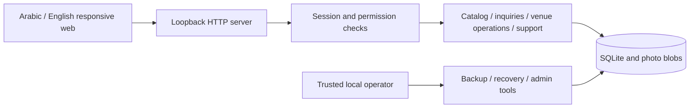

# Local implementation and production boundary

## Current implementation

One Node.js process serves native browser modules, validates API calls and owns a local SQLite database. There are no runtime dependencies. SQLite transactions protect publication, replies, membership changes, date updates and support responses. The database and browser remain the authoritative and presentation layers respectively; browser values never grant access or confirm a booking.

| Role | Catalog and saved venues | Inquiries / messages | Listing / calendar | Team | Reviews / support |
|---|---|---|---|---|---|
| Guest | Browse; favorites in browser | Own session only | None | None | None |
| Customer | Browse; own account favorites | Own account only | None | None | Own tickets |
| Vendor owner | Same as account | Own venues | Own venues | Own venues | Own tickets |
| Editor | Same as account | Only with reply access | Assigned venues | None | Own tickets |
| Responder | Same as account | Assigned venues | None | None | Own tickets |
| Both | Same as account | Assigned venues | Assigned venues | None | Own tickets |
| Explicit admin | Same as account | No blanket private conversation access | Review submissions/photos | No implicit venue membership | All venue reviews and support tickets |

Admin permission is independent of account role. The local operator already has operating-system/database access and is trusted; public deployment must not expose operator commands or transport preview data.

## Data model

- Accounts link to stable request owners; rotating sessions link to accounts without moving inquiry ownership.
- Venue submissions link to owners and memberships. The published catalog stores a reviewed snapshot. Spaces/packages/media references live within that snapshot.
- Photo blobs belong to submissions; the HTTP route checks published references or editor/admin permission before serving them.
- Requests have unique customer fingerprints, optimistic versions, immutable selection snapshots for new records, a response and status history. Conversations link to requests and retain only a role label in the public response.
- Availability keys are venue/space/date/session, with separate actor history. Explicit blocks never imply a live reservation model.
- Favorites and notifications belong to accounts. Support tickets and their admin response histories are separate from private inquiries.
- Additive migrations preserve old tables and data. `user_version=6` describes the current local schema; backup recovery is checked separately from startup.

## Classification and controls

| Data | Visibility / current protection |
|---|---|
| Approved venue content and selected photos | Public locally; owner-supplied, subject to content review |
| Pending listings and unselected photos | Owner/editors and explicit admins |
| Inquiries and messages | Customer owner and authorized venue responders |
| Support text | Submitting account and explicit admin |
| Email, password hashes, session hashes, recovery material | Private database; session cookie HttpOnly; no public database/static routes |
| Local backups | Owner-only files; include private data; trusted storage required |

Controls include bounded bodies/images/collections, selection allowlists, escaped user text, origin and CSRF checks, persistent authentication throttling, server-side access checks, security headers, loopback binding and a production-mode refusal. Photos are displayed as raster content with `nosniff`; uploaded data is never a script or executable file. No third-party analytics or fonts are loaded.

Notifications retain 90 days; security links expire and are pruned. A final retention/deletion policy for accounts, photos, inquiries, support and backups requires an operational decision. No such business policy has been invented.

## Production work that remains dependent

The original NestJS/PostgreSQL/PostGIS architecture is a proposal, not the implementation of this preview. A production migration needs an agreed hosting/stack decision, shared auth/session model, secure cookie/HTTPS configuration, managed database and object storage, secret management, backups/monitoring and release ownership. The CI definition is prepared but not connected to a remote repository.

Map/location search needs accurate venue coordinates, permission to publish them and a chosen map service. Native app/store release needs a separate mobile build and release scope. Public SEO pages should be built for the selected public hosting/routing system; the current hash-routed preview is not an SEO launch.

Booking confirmation, deposits, cancellation/refund rules, authoritative availability, holds and expiry must be agreed before a transaction engine is introduced. That engine must have database conflict constraints, idempotent gateway callbacks and concurrency/failure checks. The inquiry preview deliberately makes no transactional promises.
